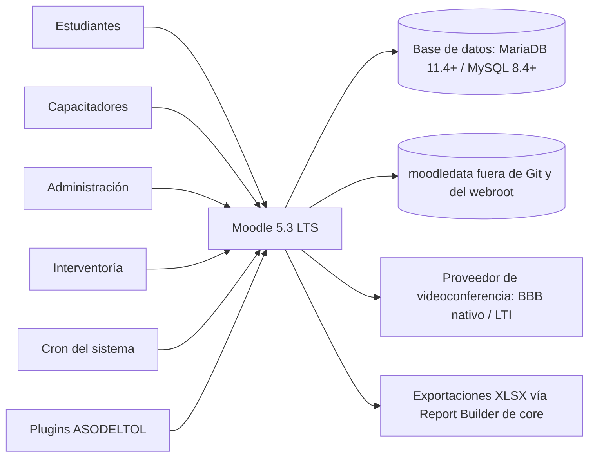
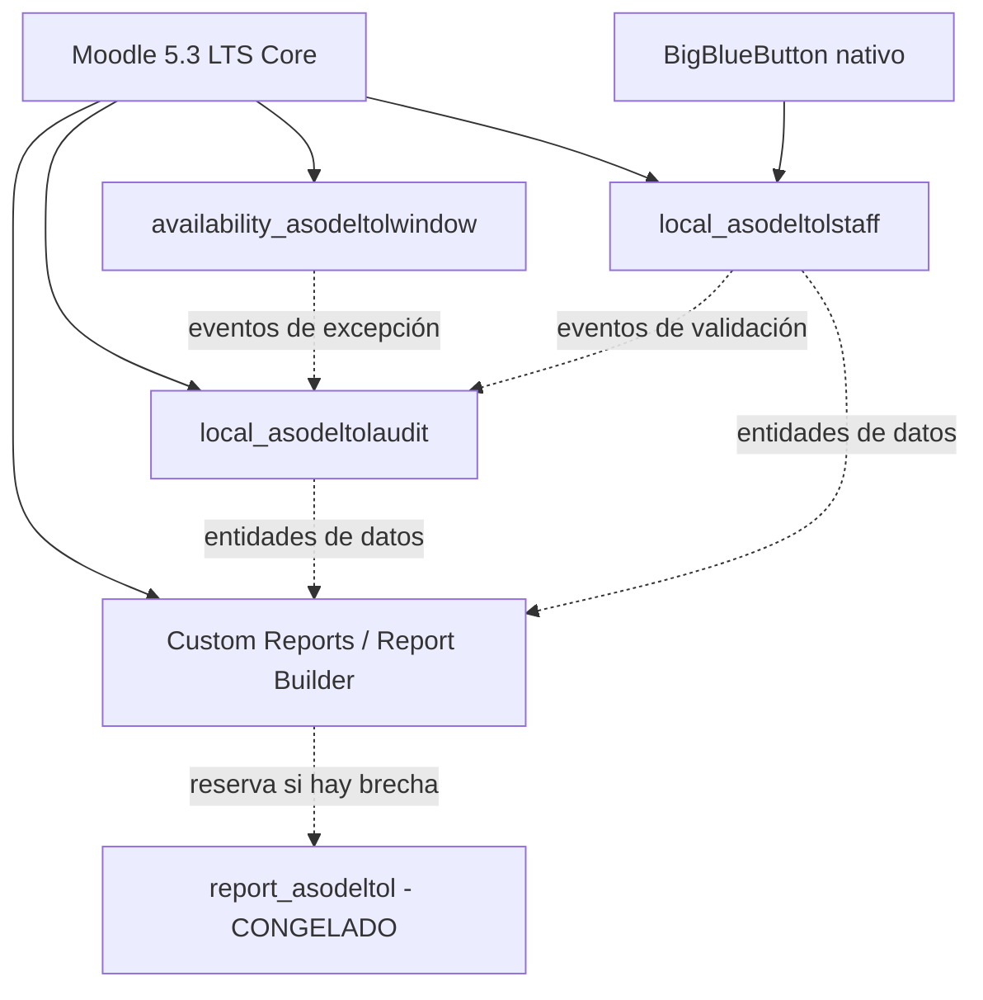

# Arquitectura propuesta

## 1. Propósito y límites

ASODELTOL se implementará como configuración y extensiones de la instalación existente de Moodle. No es un LMS nuevo. El núcleo de Moodle queda fuera de este repositorio y no se modifica. Todo código propio debe ser un plugin compatible con **Moodle 5.3 LTS y PHP 8.4** ([ADR-0004](adr/0004-objetivo-moodle-53-lts-y-documentroot-public.md)).

La versión previa Moodle 5.0.10+ finalizó su soporte de seguridad el 5 de octubre de 2026. Moodle 5.3 LTS garantiza soporte de parches hasta octubre de 2029. La arquitectura adopta la reestructuración del árbol web introducida en Moodle 5.1+, en la cual el servidor web (NGINX en CloudPanel) apunta su `DocumentRoot` exclusivamente a `/public`, manteniendo `config.php`, dependencias y librerías fuera de la raíz web expuesta.

Esta arquitectura es un punto de partida técnico verificable. No define contenidos académicos ni resuelve decisiones contractuales pendientes.

## 2. Contexto lógico



Los datos enviados a un proveedor de videoconferencia se limitan al mínimo acordado. El proveedor, residencia de datos, retención de grabaciones y base jurídica siguen pendientes.

## 3. Modelo provisional del diplomado y protocolo de piloto (ADR-0005)

Como diseño base provisional, se adopta un curso AF8 con cinco secciones/unidades y siete grupos separados de hasta 50 estudiantes (`AF8-G01` a `AF8-G07`). Cada cohorte de matrícula se sincroniza automáticamente con su grupo mediante `enrol_cohort`. Esta opción evita siete copias divergentes del contenido académico y permite centralizar la auditoría.

**Aclaración de seguridad fundamental:** El modo de "Grupos separados" en Moodle constituye una **frontera lógica de autorización basada en capacidades**, no un aislamiento físico en base de datos. Por ende, la adopción definitiva de este modelo está estrictamente condicionada a la superación de un piloto formal en staging con datos sintéticos.

### Matriz comparativa de decisión y validación de piloto

| Dimensión | Opción A: 1 Curso AF8 con 7 Grupos Separados | Opción B: Aula Modelo en 7 Cursos Independientes | Criterio de Pase en Piloto (Staging) |
|---|---|---|---|
| **Aislamiento de participantes** | Lógico por capacidades (`moodle/site:accessallgroups` revocado). | Físico por separación de registros (`courseid`). | Ningún estudiante puede listar perfiles de otros grupos en participantes ni mensajes. |
| **Visibilidad de calificaciones** | Filtrado por grupo en el libro de calificaciones unificado. | Aislamiento total en libros de calificaciones independientes. | Docente solo ve calificaciones de su grupo; estudiante solo ve sus notas. |
| **Permisos de capacitadores** | Profesor con edición, limitado a grupos autorizados y con `moodle/site:accessallgroups = Prohibit`. | Docente matriculado exclusivamente en su curso. | Puede gestionar actividades/calificaciones autorizadas; el acceso forzado por URL a otro grupo es denegado. |
| **Permisos de Interventoría** | Rol auditor con `accessallgroups = Allow` en modo lectura. | Auditor matriculado en 7 cursos distintos. | Interventoría puede auditar y exportar los 7 grupos sin capacidad de alterar notas. |
| **Foros y entregas** | Forzar grupos separados a nivel de curso (`groupmodeforce = 1`). | Foros y buzones aislados por curso. | Publicación en un foro o entrega de tarea solo es visible para el grupo correspondiente. |
| **Restricciones por fechas diferentes** | Requiere plugin `availability_asodeltolwindow` con disparador por grupo. | Fechas nativas configuradas independientemente por curso. | Si Grupo 1 y Grupo 2 inician en fechas distintas, los 8 días hábiles computan correctamente. |
| **Exportación y reportes** | Unificado: un solo reporte consolida 350 estudiantes o filtra por grupo. | Fragmentado: exige descargar y consolidar 7 archivos XLSX independientes. | Report Builder genera reporte consolidado de 350 registros sin sobrepasar memoria de PHP. |
| **Mantenimiento académico** | Excelente: una errata o ajuste de recurso se edita una sola vez. | Crítico: cualquier cambio debe replicarse manualmente 7 veces con riesgo de desincronización. | Tiempo de mantenimiento y riesgo de divergencia evaluados por el equipo académico. |

Configuración nativa requerida para la Opción A:
- Categoría propia para AF8 y curso de edición controlada.
- Cohortes `AF8-G01` a `AF8-G07`, sincronizadas a grupos homónimos mediante `enrol_cohort`.
- Modo de grupos forzado en ajustes del curso: `groupmode = 1` y `groupmodeforce = 1`.
- Cinco secciones de 16 horas y diez componentes enumerados por sección; la contradicción 50/80 permanece abierta y no se crean 30 ítems adicionales.
- Finalización de actividad con criterios objetivos y calificación aprobatoria definida por la coordinación académica.
- Restricción de cada unidad por finalización/aprobación de la anterior.
- Libro de calificaciones con categorías por unidad, identificadores estables y escala aprobada.

### 3.1 Catálogo y límite de automatización

`catalog/af8/catalog.json` es la fuente versionada de estructura; usa plantillas de componente para mantener títulos/tipos coherentes y conserva instancias con códigos `UTn.xx` e identificadores estables. El validador Node.js aplica invariantes cruzadas que JSON Schema por sí solo no expresa con claridad. La matriz de acceso es un contrato de pruebas, no una exportación de roles.

El flujo funcional es:

```text
catálogo + matriz → validación local → CSV oficiales + plano + manifiesto
                                      ↓
                         previsualización/importación en staging
                                      ↓
                 configuración nativa + auditoría de estructura/acceso
```

La carga oficial de cursos crea el curso oculto y, después de cargar las cohortes, configura siete sincronizaciones con `enrolment_N_addtogroup=1`. La creación completa de actividades no se simula: se realiza con la interfaz estándar, un curso plantilla/restore validado o un futuro componente administrativo soportado. El procedimiento está en `APROVISIONAMIENTO_AF8.md`.

La navegación usa el formato por temas de Moodle: portada/sección general, índice y progreso nativos, cinco unidades homogéneas, mensajes de restricción, calificaciones, calendario y recursos/grabaciones. Todo contenido debe ser responsive y cumplir teclado, foco, jerarquía semántica, contraste, alternativas textuales y subtítulos; no se introduce una aplicación React separada.

## 4. Clasificación: core, plugin existente y desarrollo propio

| Necesidad | Solución prioritaria | Clasificación | Observación |
|---|---|---|---|
| Curso, cinco unidades y 80 horas declaradas | Curso, secciones, calendario y etiquetas de Moodle 5.3 | Nativo | Horas declaradas no prueban asistencia efectiva. |
| 350 estudiantes en siete grupos | Cohortes, sincronización de cohortes, grupos y agrupamientos | Nativo | Sujeto a validación de segregación en piloto de staging. |
| Secuencia por aprobación | Finalización de actividad, calificación para aprobar y restricción de acceso | Nativo | Configurar criterios verificables; no desarrollar motor paralelo. |
| Fechas absolutas de apertura/cierre | Restricción por fecha nativa de Moodle | Nativo | No cubre por sí sola ocho días hábiles individuales por cohorte. |
| Ocho días hábiles y excepciones auditables | `availability_asodeltolwindow` | Personalizado | Integra festivos de Colombia (Ley Emiliani), grupos y caché MUC. |
| Roles administrativos y académicos | Roles, capacidades y contextos | Nativo/configuración | Interventoría en modo lectura transversal; capacitador limitado a grupo. |
| Matrícula y bajas | Sincronización de cohortes (`enrol_cohort`) y CSV sintético | Nativo | Validar bajas y suspensiones sin destruir historial. |
| Progreso y calificaciones | Informes de finalización y libro de calificaciones de Moodle 5.3 | Nativo | Respalda historial y ponderaciones por unidad. |
| Asistencia efectiva | BigBlueButton nativo / `mod_attendance` evaluado | Core / Plugin tercero | Evaluar primero capacidades nativas de reunión de Moodle 5.3. |
| Logs técnicos y actividad | Eventos y logs estándar (`logstore_standard`) | Nativo | Indicios auxiliares; no equivalen a trabajo ni jornada. |
| Auditoría de decisiones de negocio | `local_asodeltolaudit` | Personalizado mínimo | Registra excepciones y validaciones vía `\core\event\base`. |
| Reportes consolidados contractuales | Custom Reports / Report Builder de Moodle 5.3 LTS | Nativo de core | **Congela `report_asodeltol`** salvo brecha contractual insalvable. |
| Disponibilidad sincrónica del capacitador | Calendario + telemetría BBB + validación formal (`local_asodeltolstaff`) | Nativo + personalizado | Modelo de 3 niveles: Planificado, Observado y Validado. |
| Videoconferencia y grabaciones | BigBlueButton nativo de Moodle 5.3 o LTI 1.3 | Nativo / Integración | Sin desarrollo propio; retención y privacidad aprobadas. |
| Protección de datos personales | Capacidades, Privacy API (Ley 1581) y retención legal | Nativo + plugins propios | Los datos de certificación académica tienen custodia legal obligatoria. |

## 5. Diseño de plugins propios

Los directorios actuales contienen únicamente contratos de diseño y no deben copiarse a Moodle como plugins instalables.

### 5.1 `availability_asodeltolwindow`

Tipo y destino: `availability`, en `availability/condition/asodeltolwindow`.

Responsabilidad única: decidir si una actividad o sección está disponible para un estudiante dentro de una ventana de días hábiles (máximo ocho días hábiles por módulo) y gestionar excepciones auditables.

Requisitos de diseño obligatorios:
- **Calendario laboral colombiano (Ley 51 de 1983 — Ley Emiliani):** Incorpora festivos fijos, festivos trasladados al lunes y festivos móviles de Pascua. No depende de servicios web externos.
- **Disparador por grupo o finalización:** Soporta fechas de inicio escalonadas por cohorte (`AF8-G01` a `AF8-G07`) o cómputo a partir de la finalización de la unidad previa.
- **Estrategia de caché en memoria (MUC):** El método `is_available()` se ejecuta en cada renderizado de módulo. Para prevenir degradación tipo $N+1$ en el VPS KVM 2 (2 vCPU), las consultas de festivos y fechas de inicio se almacenan en MUC (`core_cache`) con invalidación orientada a eventos.
- **Excepciones inmutables:** Toda prórroga conserva beneficiario, días adicionales, justificativo, actor y fecha UTC, emitiendo un evento auditable ante cambios.

### 5.2 `local_asodeltolaudit`

Tipo y destino: `local`, en `local/asodeltolaudit`.

Responsabilidad: conservar hechos de negocio ASODELTOL que requieren trazabilidad especializada (aprobación/revocación de excepciones, atestación de disponibilidad y ajustes justificados).

Requisitos de diseño:
- **Arquitectura de eventos estándar:** Subclases de `\core\event\base` para cada hecho de dominio y observadores registrados en `db/events.php`.
- **Historia anexable (*Append-only*):** Tablas de auditoría protegidas contra edición o borrado; toda modificación añade un nuevo registro que referencia al anterior.
- **Fuentes para Report Builder:** Expone entidades y fuentes de datos (*Report Builder DataSources*) para que los informes nativos de Moodle 5.3 puedan incluir hechos de negocio sin requerir un plugin de reporte separado.
- **Privacy API y Custodia Legal (Ley 1581 de 2012):** Declara causal de conservación legal para datos de certificación académica frente a solicitudes de supresión de datos personales.

### 5.3 `report_asodeltol` (CONGELADO PROVISIONALMENTE)

Tipo y destino: `report`, en `report/asodeltol`.

Estado: **Congelado provisionalmente**.
- Moodle 5.3 LTS cuenta con el subsistema nativo de *Custom Reports / Report Builder*, con capacidad de filtrado por grupos, exportación a XLSX/CSV y control por capacidades.
- La creación de un plugin monolítico de reportería queda suspendida hasta recibir el catálogo formal de reportes contractuales (DP-012) y verificar en staging que existe una brecha insalvable mediante el Report Builder de core.
- En caso de requerir fuentes especializadas, se priorizará agregar entidades en `local_asodeltolaudit` o `local_asodeltolstaff`.

### 5.4 `local_asodeltolstaff`

Tipo y destino: `local`, en `local/asodeltolstaff`.

Responsabilidad: seguimiento de la disponibilidad sincrónica del capacitador cuando las herramientas nativas requieran atestación adicional. El modelo separa estrictamente:
1. **Horario Planificado:** Bloques programados por grupo en el Calendario oficial.
2. **Presencia Observada:** Telemetría técnica de la videoconferencia (BigBlueButton nativo / LTI) o interacción verificable en plataforma.
3. **Cumplimiento Validado:** Atestación formal por el coordinador o interventor, con registro inmutable de ajustes.
- **Regla negativa:** Los inicios de sesión o estado "en línea" se tratan exclusivamente como indicios técnicos auxiliares, nunca como prueba de jornada.

## 6. Dependencias entre componentes



Las dependencias obligatorias se declaran en `version.php` y se verifican en CI. Ningún componente fallará de forma insegura si un plugin opcional no está instalado.

## 7. Roles y acceso

Las comprobaciones se hacen por capacidades, no por nombre de rol.

| Rol de negocio | Base sugerida | Alcance | Restricciones clave |
|---|---|---|---|
| Administrador | Administrador sólo para 1–2 cuentas; Manager para operación | Sistema/categoría | Cuentas separadas, MFA si está disponible, mínimo uso cotidiano del administrador. |
| Capacitador | Profesor con edición restringido por capacidades y asignación | Curso/grupo autorizado | Gestiona contenidos, actividades y notas de su alcance; `accessallgroups` prohibido. |
| Estudiante | Estudiante | Curso y grupo | Sólo sus datos, actividades y calificaciones. |
| Interventoría/Auditoría | Rol personalizado desde capacidades mínimas | Categoría/curso, preferiblemente lectura | Ver reportes y evidencia; sin editar cursos, notas, usuarios o evidencias; exportar sólo si se aprueba. |

Antes de activar Interventoría se debe ejecutar un informe de capacidades y pruebas negativas de acceso directo por URL.

## 8. Datos y trazabilidad

Fuentes de verdad propuestas:

- Moodle core: usuarios, matrículas, grupos, finalización, calificaciones y logs técnicos.
- `mod_attendance`, si se aprueba: sesiones y estados de asistencia.
- `availability_asodeltolwindow`: políticas temporales y excepciones.
- `local_asodeltolstaff`: horarios, declaraciones y validaciones de disponibilidad.
- `local_asodeltolaudit`: hechos y correcciones propios de ASODELTOL.
- Proveedor de videoconferencia: reunión y grabación, referenciadas por identificador; no replicadas sin necesidad.

Fechas persistidas en UTC y mostradas con zona horaria aprobada. Los reportes deben incluir origen y momento de corte. Los identificadores de usuario que aparezcan en exportaciones deben limitarse a los campos contractualmente necesarios.

## 9. Integración y despliegue

El repositorio conserva cada plugin en su ruta lógica bajo `plugins/`. El proceso de versión crea un ZIP por componente, checksum SHA-256 y manifiesto; nunca copia automáticamente a producción. En staging se instala el paquete con la misma versión exacta que luego sea aprobada.

Orden futuro sugerido:

1. inventario y respaldo verificable;
2. modo mantenimiento sólo durante la ventana aprobada;
3. instalación de código versionado;
4. actualización mediante CLI de Moodle;
5. purga de cachés, tareas y pruebas de humo;
6. reapertura y monitorización;
7. reversión por restauración conjunta de código, base de datos y `moodledata` si la migración no es reversible.

La operación detallada está en `OPERACION.md`. Ninguno de estos pasos se ejecutó en esta misión.

## 10. Capacidad, disponibilidad y política de caché (Redis)

El dimensionamiento de Hostinger KVM 2 (2 vCPU, Ubuntu 24.04, CloudPanel) impone límites estrictos de concurrencia:
- **No instalar Redis prematuramente:** Aunque CloudPanel facilita la activación de Redis con un clic, activar un servicio adicional sin medir consumo añade huella de memoria residente (~100-200 MB+) y cambios de contexto en un procesador de 2 vCPU.
- **Régimen de evaluación basado en datos:**
  1. En staging, realizar la prueba de carga inicial utilizando el motor de caché nativo en archivo / APCu para MUC y sesiones en base de datos.
  2. Medir tres métricas críticas durante un simulacro de 50 estudiantes concurrentes (ejecución simultánea de cuestionarios y reportes):
     - *Carga de CPU promedio:* si el load average supera 1.8 de forma sostenida.
     - *Contención de bloqueos:* si se registran timeouts de espera en la tabla `mdl_sessions` o bloqueos de caché.
     - *I/O Wait:* si el porcentaje de espera en disco supera el 15%.
  3. **Criterio de decisión:** Solo si se comprueba empíricamente contención en sesiones o sobrecarga de disco, se habilitará Redis como almacén de sesiones (`$CFG->session_handler_class = '\core\session\redis'`) y backend de MUC (`cachestore_redis`), dimensionando la memoria máxima de Redis a 256 MB con política `volatile-lru`.
- **Videoconferencias externas:** Las sesiones sincrónicas y grabaciones deben residir exclusivamente en la infraestructura del proveedor (BigBlueButton externo / LTI); el VPS KVM 2 no debe procesar ni almacenar flujos de video ni audio.

## 11. Fuentes y vigencia

Las capacidades y mecanismos se contrastaron con documentación oficial de Moodle 5.x y la rama `MOODLE_503_STABLE`. Véase `FUENTES.md`. Las versiones y el estado de soporte deben reevaluarse antes de cada ciclo de implementación.
